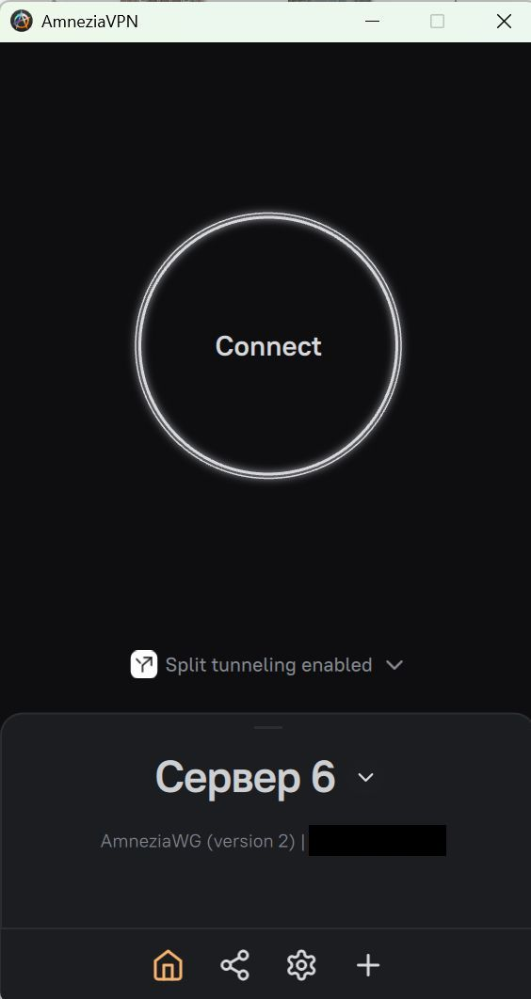
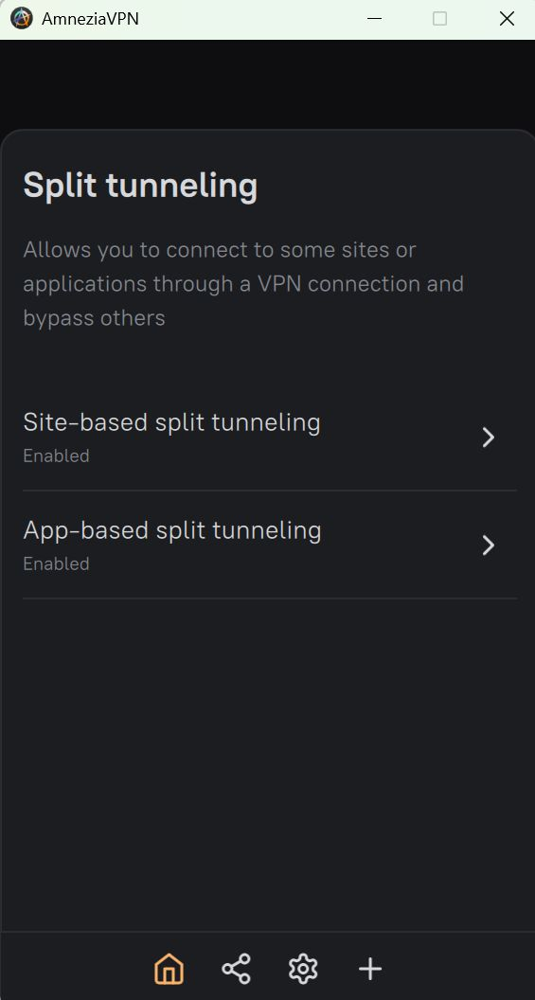
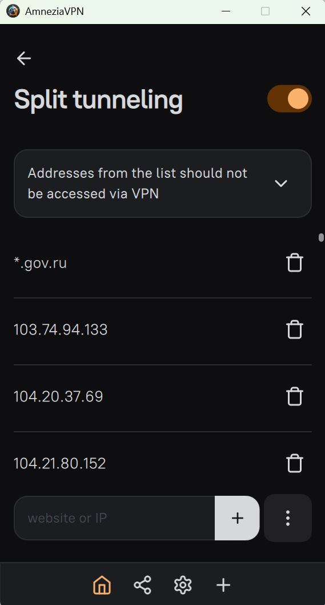
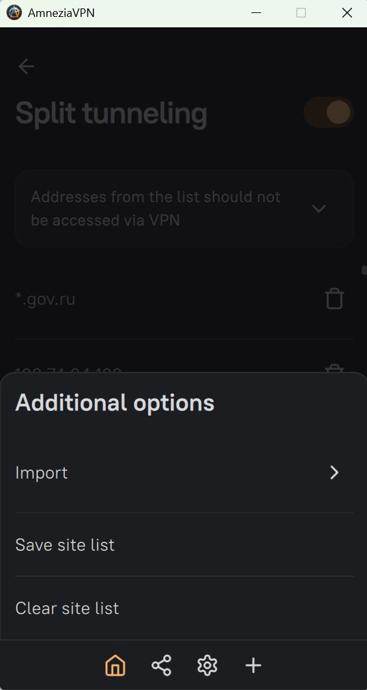
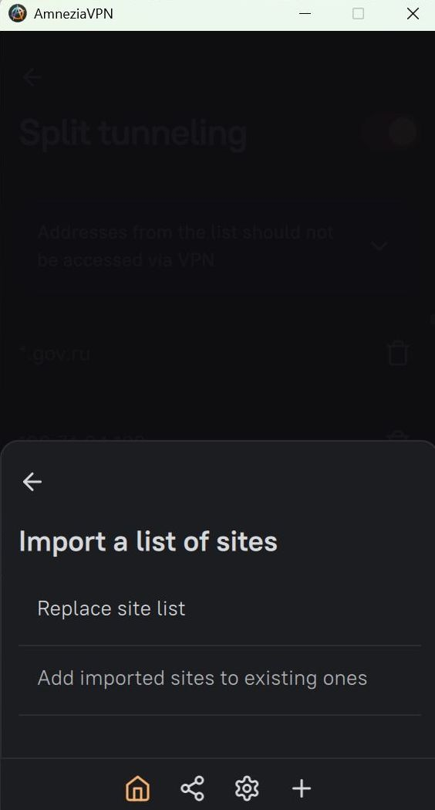

Addresses from the list should not be accessed via VPN for Amnezia VPN

Список адресов российских доменов, на которые не нужно заходить через VPN. Это список для российских пользователей в условиях нынешнего развития рунета.

В настройках Amnezia VPN заходим Split tunneling enabled -> Site-based split tunneling -> добавляем список через "три точки" и не забываем активировать.

Цель: 
* минимизировать зарубежный трафик для российских сервисов:
  + минимизация нагрузки на канал связи с VPN сервером;
  + уменьшить личную нагрузку на магистральный зарубежный канал;
  + не попасть поб блокировки соединений с VPN на российских сервисах;
* лишний раз не "выдавать" адрес своего зарубежного хоста (на случай если забыли выключить VPN).

Добавил некоторые иностранные (не все субдомены), популярные, не заблокированные ресурсы (microsoft, github, reddit, google, python), чтобы разбавить трафик через VPN.

**ВНИМАНИЕ**
При использовании списка, ваш российский ip виден для ресурсов из списка. Будьте аккуратны.

Если хотите добавить домены, пишите в Issue или Duscussions (не знаю куда правильнее)

Добавляем/обновляем список доменов, на которые не нужно заходить через VPN  
  
  
  
  
  
Далее выбираем файл amnezia_sites.json.

## ❤️ Поддержать проект
Этот проект бесплатный и развивается в свободное время.

Если он оказался полезен, вы можете поддержать дальнейшую разработку:
[❤️ Поддержать на Boosty](https://boosty.to/USERNAME)

Спасибо за поддержку!
